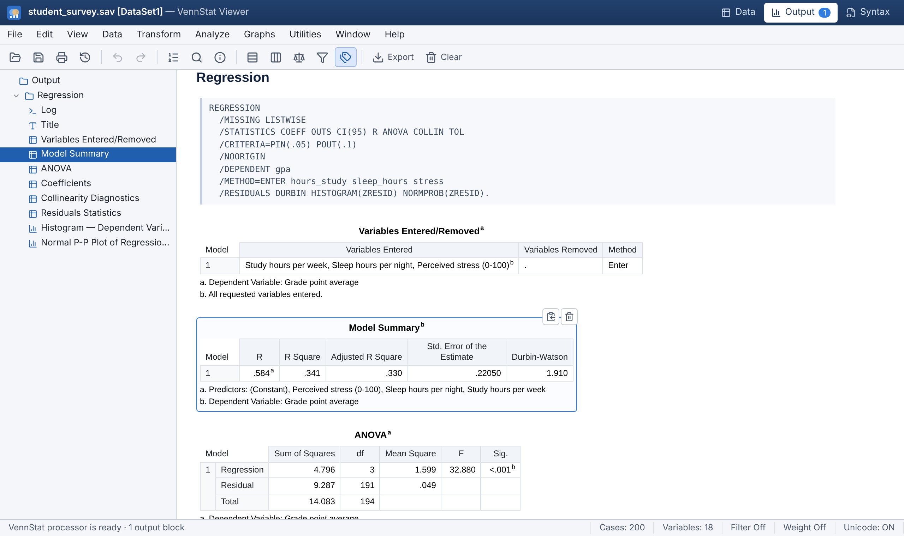
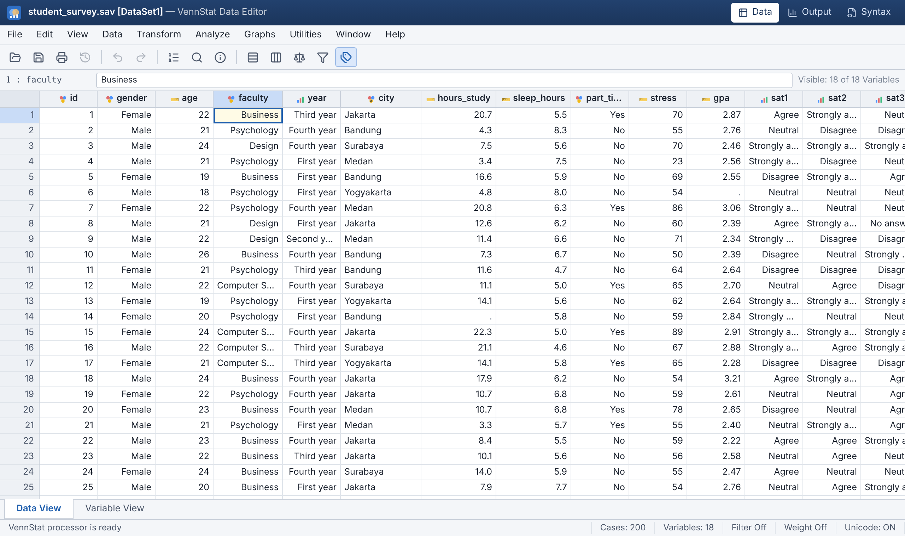
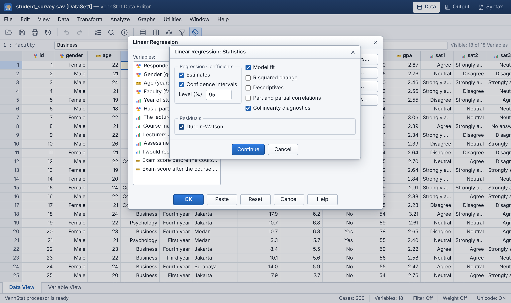
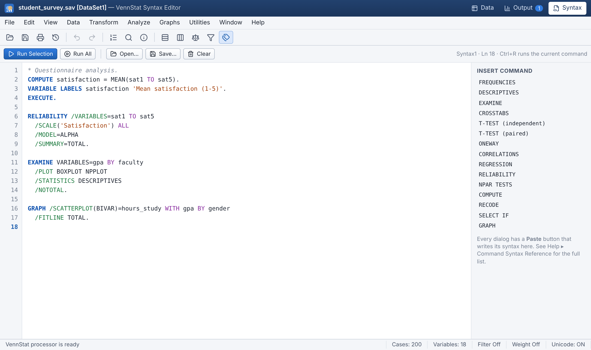
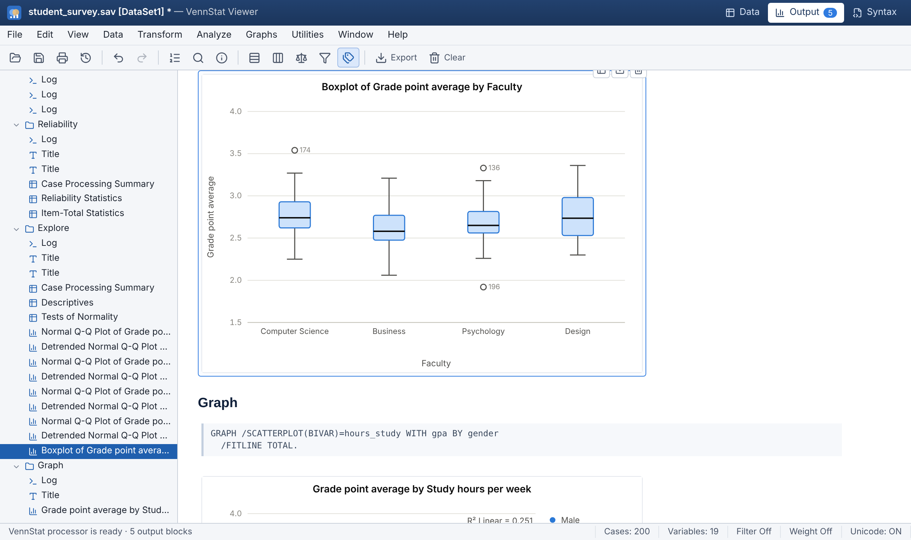

# VennStat

**A statistics package that runs in your browser, with the workflow of SPSS** — a Data View and Variable View,
SPSS-style dialogs with a *Paste* button, pivot-table output, and command syntax. Everything runs locally in the tab:
no server, no upload, no install.



| Data View with value labels | Linear Regression dialog |
| --- | --- |
|  |  |
| **Syntax Editor** | **Charts** |
|  |  |

## Features

**Data Editor**
- Virtualized **Data View** grid with keyboard navigation, range selection, copy/paste to and from Excel or Google Sheets,
  undo/redo, and context menus (insert/delete, sort, quick descriptives). Typing into an empty column or row creates the
  variable or case, as in SPSS.
- **Variable View** for name, type, width, decimals, label, value labels, missing values (discrete or range), columns,
  alignment, measurement level and role.
- *View ▸ Value Labels* toggle, filtered-out cases marked in the row headers, and a status bar showing Filter and Weight.

**Analyze** (each dialog has OK / Paste / Reset / Cancel / Help and remembers its settings)

| Menu | Procedures |
| --- | --- |
| Descriptive Statistics | Frequencies (statistics, percentiles, bar/pie/histogram), Descriptives (incl. saving z-scores), Explore (trimmed mean, percentiles, extremes, **Kolmogorov-Smirnov with Lilliefors correction and Shapiro-Wilk**, Q-Q plots, boxplots, stem-and-leaf), Crosstabs (Pearson χ², continuity correction, likelihood ratio, Fisher's exact, linear-by-linear, phi, Cramér's V, contingency coefficient, odds ratio and relative risk, expected counts, percentages, residuals) |
| Compare Means | Means (with ANOVA and eta), One-Sample / Independent-Samples (Levene, Welch) / Paired-Samples T Test with Cohen's d, One-Way ANOVA (Levene based on mean, median and trimmed mean; Welch and Brown-Forsythe; post hoc LSD, Bonferroni, Sidak, Scheffé, **Tukey HSD**, Games-Howell; means plot; effect sizes) |
| Correlate | Pearson, Spearman's rho and Kendall's tau-b with flagged significance |
| Regression | Linear regression (Enter, Stepwise, Forward, Backward): R² change, CIs, part/partial correlations, **tolerance/VIF and collinearity diagnostics**, Durbin-Watson, residual histogram, normal P-P plot, ZRESID × ZPRED plot, saving predicted values and residuals |
| Scale | Reliability analysis: Cronbach's alpha (and standardized), split-half, item statistics, **item-total statistics / alpha if item deleted** |
| Nonparametric (legacy) | χ² goodness of fit, one-sample K-S, Mann-Whitney U (asymptotic and exact), Kruskal-Wallis H, Wilcoxon signed-rank, Friedman |
| Graphs (legacy) | Bar (simple/clustered; count, %, mean, median, sum), line, pie, histogram with normal curve, scatter with groups and fit line, boxplots |

**Transform & Data** — Compute Variable (expression builder with ~60 functions, `MEAN(q1 TO q5)`, `If…` conditions),
Recode into Same/Different Variables, Automatic Recode, Rank Cases, Sort Cases, Select Cases (condition, random sample,
filter variable; filter or delete), Weight Cases (frequency weights).

**Output Viewer** — an outline tree and SPSS-style pivot tables with footnotes. Each table can be copied as rich HTML
(it pastes into Word or Google Docs as a table) and each chart downloaded as PNG or shown as a data table. *File ▸ Export
Output* writes the whole session to a standalone HTML file.

**Command syntax** — every dialog can *Paste* its command into the **Syntax Editor**, which has highlighting and runs
the selection or the current command with `Ctrl+R`. The parser understands a practical subset of SPSS syntax, including
three-letter keyword abbreviations, `TO`/`ALL` variable lists and comments:

```spss
COMPUTE satisfaction = MEAN(sat1 TO sat5).
RECODE age (LO THRU 29=1) (30 THRU 49=2) (50 THRU HI=3) INTO agegroup.
VALUE LABELS agegroup 1 'Under 30' 2 '30-49' 3 '50+'.
RELIABILITY /VARIABLES=sat1 TO sat5 /MODEL=ALPHA /SUMMARY=TOTAL.
EXAMINE VARIABLES=gpa BY faculty /PLOT BOXPLOT NPPLOT /NOTOTAL.
REGRESSION /STATISTICS COEFF OUTS CI(95) R ANOVA COLLIN TOL
  /DEPENDENT gpa /METHOD=ENTER hours_study sleep_hours stress
  /RESIDUALS DURBIN HISTOGRAM(ZRESID) NORMPROB(ZRESID).
```

Supported commands: `FREQUENCIES`, `DESCRIPTIVES`, `EXAMINE`, `CROSSTABS`, `MEANS`, `T-TEST`, `ONEWAY`, `CORRELATIONS`,
`NONPAR CORR`, `REGRESSION`, `RELIABILITY`, `NPAR TESTS`, `GRAPH`, `COMPUTE`, `IF`, `RECODE`, `AUTORECODE`, `RANK`,
`SORT CASES`, `SELECT IF`, `FILTER`, `USE ALL`, `WEIGHT`, `SAMPLE`, `VARIABLE LABELS`, `VALUE LABELS`,
`ADD VALUE LABELS`, `MISSING VALUES`, `VARIABLE LEVEL`, `FORMATS`, `STRING`, `NUMERIC`, `DELETE VARIABLES`,
`RENAME VARIABLES`, `EXECUTE`, `TITLE` (see *Help ▸ Command Syntax Reference* in the app).

**Files** — open and save **SPSS `.sav`** (uncompressed, bytecode-compressed and `.zsav`; labels, value labels, missing
values, measurement levels, long names and very long strings), import CSV/TSV with delimiter and decimal-comma detection,
export CSV, and save `.vstat` projects (data plus syntax). The session is autosaved in the browser (IndexedDB), so a reload
brings back the data, output and syntax. Three synthetic sample datasets are built in (*File ▸ Open Sample Data*).

## Accuracy

The numerical core is written from scratch in TypeScript (no statistics dependencies) and follows SPSS's definitions:
sample variance, G1/G2 skewness and kurtosis with their standard errors, HAVERAGE percentiles, Tukey's hinges, the
fractional 5% trimmed mean, Royston's Shapiro-Wilk (AS R94), Dallal-Wilkinson Lilliefors significance, tie-corrected rank
tests, and a studentized-range distribution for Tukey/Games-Howell.

The unit tests compare results with **SciPy, statsmodels and pingouin** reference values: distribution functions,
t-tests, Levene, Welch ANOVA, Tukey HSD, Games-Howell, correlations, Mann-Whitney, Wilcoxon, Kruskal-Wallis, Friedman,
Shapiro-Wilk for n = 3…300, Lilliefors, OLS regression (coefficients, SEs, R², F, VIF, Durbin-Watson), crosstab χ² /
likelihood ratio / Yates / Fisher, and Cronbach's alpha. The `.sav` writer's output was checked against `pyreadstat`.

## Getting started

Requires Node.js 22.12 or newer.

```bash
npm install
npm run dev        # http://localhost:5173
```

| Script | What it does |
| --- | --- |
| `npm run dev` | Vite dev server |
| `npm test` | Vitest unit tests (statistics, syntax round trips, transformations, `.sav`) |
| `npm run e2e` | Playwright end-to-end tests against a production build (`npx playwright install chromium` once) |
| `npm run typecheck` / `npm run lint` | TypeScript and oxlint |
| `npm run build` | Static production build in `dist/` |

The build is a static site with relative asset paths, so `dist/` can be hosted anywhere (GitHub Pages, Netlify, Vercel,
an S3 bucket). `.github/workflows/pages.yml` deploys to GitHub Pages: set *Settings ▸ Pages ▸ Source* to **GitHub
Actions**, then run the workflow from the Actions tab. `.github/workflows/ci.yml` runs typecheck, lint, unit tests,
build and end-to-end tests on pushes to `main` and on pull requests.

## Project layout

```
src/
  core/          dataset model (variables, missing values, value labels), SPSS-style number formatting, output model
  stats/         distributions, descriptive building blocks, hypothesis tests, normality tests, small linear algebra
  procedures/    one module per procedure (tables + charts), command specs, and the execution engine
  syntax/        command splitter, tokenizer and parser; spec → syntax generator
  transform/     expression language for COMPUTE / IF / SELECT IF, and the data transformations
  io/            .sav reader/writer, CSV, .vstat projects
  samples/       deterministic synthetic sample datasets
  state/         zustand store (undo/redo, output, dialogs) and IndexedDB autosave
  ui/            data grids, menus, dialogs (declarative framework + custom dialogs), output viewer, charts, syntax editor
e2e/             Playwright tests
```

Dialogs, the syntax parser and the engine meet in one place: a dialog builds a typed command spec, *Paste* turns it
into syntax with the generator, and the Syntax Editor parses syntax back into the same specs. Round-trip tests keep the
generator and parser in step.

## Limitations

VennStat covers the procedures most often used in coursework and survey research, not the whole of SPSS. Not yet
available: GLM / repeated-measures ANOVA, logistic regression, factor analysis, cluster analysis, Split File, date and
time variables, `DO IF`/`LOOP`/`VECTOR` in syntax, and editing pivot tables in place. Frequency weights are applied by
replicating cases (non-integer weights are rounded). Analyses run on the main thread, so very large datasets (hundreds of
thousands of cases) will feel slow.

## Disclaimer

VennStat is an independent open-source project. It is not affiliated with, endorsed by or derived from IBM. IBM SPSS
Statistics is a trademark of IBM Corporation; the name is used here only to describe the workflow VennStat follows.
